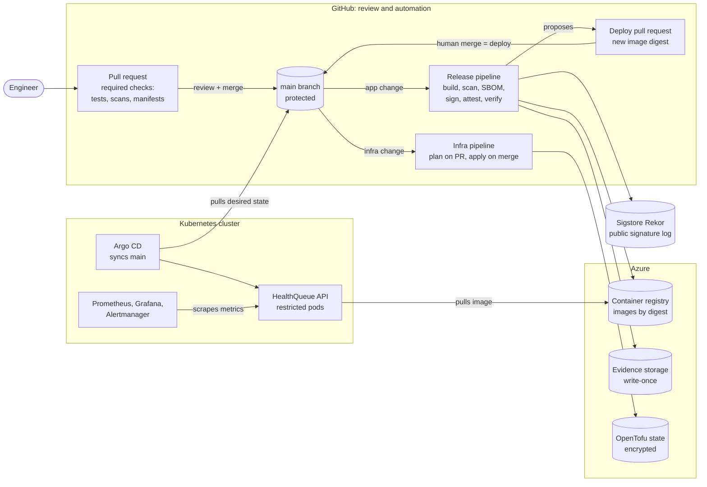

# HealthQueue Platform

A DevOps capstone, written up as a case study. It covers a patient appointment-scheduling API and
the delivery platform around it. Every production change is reviewed, traceable to its source
commit, signed, recorded in write-once storage, and reversible with one revert.

**Hannah Martinez** · All data is synthetic. No patient information is stored anywhere.

## Project Summary

HealthQueue is an appointment-booking API (FastAPI, Python 3.13). The application is
deliberately small. The project is the path it takes to production:

- **Pull request checks:** tests with a coverage gate, code and container linting, vulnerability
  and secret scanning, and Kubernetes manifest validation. All are required before merge.
- **Release:** builds the image and blocks it on fixable HIGH or CRITICAL vulnerabilities. It
  then generates an SBOM, signs the image keylessly, attests SLSA provenance, verifies all of it,
  and writes the evidence to write-once storage.
- **Promotion:** each release is proposed as a pull request that pins the new image digest.
  **Merging is the deployment; reverting is the rollback.**
- **Infrastructure:** OpenTofu manages it on Azure through the same review flow, with encrypted
  remote state and no stored cloud credentials.
- **GitOps:** Argo CD makes the Kubernetes cluster match Git and undoes manual changes.
- **Reliability:** two SLOs with an error budget, burn-rate alerts that are unit-tested in CI, a
  Grafana dashboard and runbooks.
- **Delivery metrics:** a 90-day DORA analysis with toil-reduction recommendations.

Where to look next: [architecture](docs/architecture.md),
[supply chain security](docs/supply-chain-slsa.md), [observability plan](docs/observability.md),
[DORA analysis](docs/dora-report.md), [decision records](docs/adr/README.md),
[runbooks](docs/runbooks/), [evidence per phase](docs/evidence/), and the
[course guide](docs/course-guide.md) (rubric map, phases, quickstart, API).

## Problem Statement

Teams that ship software into regulated settings answer the same questions at every audit.
Biotech and healthcare are examples, where data integrity and traceability are expected:

- **Who changed production, when, and who approved it?**
- **Is what is running exactly what was tested?** Could it have been swapped or rebuilt
  differently?
- **What is inside it,** and are we affected by the vulnerability announced this morning?
- **Can anyone reach sensitive data,** or production, with a leaked password?
- **How do we know it is working,** before users tell us?

A common answer is manual: release checklists, screenshots, shared admin accounts, and
spreadsheets of what was deployed. That approach is slow, and the records stop being trustworthy
the first time someone skips a step.

The goal here was to make the answers **a by-product of the delivery process itself**. A
one-person team should be able to ship several times a week and still hand an auditor a complete,
tamper-evident record.

| What regulated teams care about | How this project addresses it | Evidence |
|---|---|---|
| **Audit trail** | Production changes only through merged pull requests: Git history records who proposed, who approved and when. Each release writes scan results, SBOM, signature and provenance to storage that cannot be altered or deleted during retention (in the course environment the policy is unlocked, with 7-day retention; production would lock it at six years). Infrastructure changes are planned on the pull request and applied on merge. | [Phase 8](docs/evidence/phase-8-deploy-pr.md), [phase 5, WORM evidence](docs/evidence/phase-5-release.md#4-evidence-in-worm-storage) |
| **Reproducible deployments** | Images are referenced by immutable digest, never by tag. The base image is pinned by digest, dependencies by hash, GitHub Actions by commit SHA, and CI tools by checksum. Infrastructure and cluster state are declared in code. | [ADR-0006](docs/adr/0006-gitops-with-argo-cd.md), [`ci.yml`](.github/workflows/ci.yml) |
| **Signed artifacts** | cosign keyless signatures logged in the public Rekor transparency log, plus SLSA Build L2 provenance and an attested SBOM. All three are verified in the pipeline and again from a separate workstation. | [Phase 5, independent verification](docs/evidence/phase-5-release.md#3-independent-verification-from-a-workstation-not-the-ci-runner), [supply chain](docs/supply-chain-slsa.md) |
| **Protecting sensitive data** | No long-lived cloud credentials: short-lived OIDC tokens only. State is encrypted with a Key Vault key, and no secrets are kept in Git. Network traffic is denied by default, pods run under the `restricted` Pod Security profile, and logs and metrics record route templates, never patient or appointment IDs. All data is synthetic. | [ADR-0003](docs/adr/0003-github-actions-workload-identity.md), [ADR-0002](docs/adr/0002-opentofu-state-management.md), [architecture: trust boundaries](docs/architecture.md#identities-and-trust-boundaries) |

> **Scope note.** This is a course project, not a validated system. It has not been assessed
> against GxP, 21 CFR Part 11 or HIPAA. It demonstrates the engineering controls that such
> assessments rely on: attributable changes, original and tamper-evident records, and least
> privilege.

## Relevance to Moderna's DevSecOps Roles

Moderna's DevSecOps job postings list Python, TypeScript, GitHub Actions, Pulumi, Docker, AWS,
JFrog, monitoring, runbooks, dashboards and developer documentation. Here is how this project
lines up with that list.

**Already used here:** Python (the API and the DORA analysis), GitHub Actions (three workflows),
Docker, monitoring (Prometheus with burn-rate alerts), a Grafana dashboard kept as code, four
[runbooks](docs/runbooks/) and developer documentation (eight
[decision records](docs/adr/README.md) and an [architecture guide](docs/architecture.md)).

**Not used here:** TypeScript and JFrog. Images are stored in Azure Container Registry, not
Artifactory.

**Different tools, same practices:** I built this on Azure with OpenTofu and haven't used AWS or
Pulumi. The cloud services are different, but the practices behind them carry over:

| In this project | Closest AWS / Pulumi equivalent | What carries over |
|---|---|---|
| GitHub OIDC federated to Azure managed identities | GitHub OIDC with IAM roles | No stored cloud credentials; each workflow gets a short-lived, narrowly scoped identity |
| Azure Container Registry | Amazon ECR, or JFrog Artifactory | Images pushed and deployed by digest, with signatures and attestations stored next to them |
| Storage with a WORM immutability policy | S3 Object Lock | Release evidence that can't be changed or deleted during retention |
| Key Vault key encrypting the state | AWS KMS | A managed key protects infrastructure state |
| OpenTofu (HCL): plan on the pull request, apply on merge, scheduled drift checks | Pulumi (Python or TypeScript): `preview` and `up` | Reviewed infrastructure changes, state kept remotely and protected, drift detection |

The biggest difference is the language. Pulumi programs are written in Python or TypeScript, not
HCL. I'd expect to spend most of my ramp-up time learning AWS IAM and Pulumi's state and secrets
model, more than learning the workflow.

## Technologies Used

| Area | Tools (versions as pinned in the repository) |
|---|---|
| Application | Python 3.13, FastAPI, Uvicorn, `prometheus-client`, SQLite; pytest, Ruff |
| Container | Docker multi-stage build on a digest-pinned `python:3.13-slim` base; non-root UID 10001; pip removed from the runtime image |
| CI/CD | GitHub Actions (3 workflows, actions pinned by commit SHA), Dependabot |
| Security scanning | Trivy v0.75.0 (dependencies, secrets, misconfiguration, image), hadolint |
| Supply chain | Syft (SPDX 2.3 SBOM), cosign v3.1.3 keyless signing with Sigstore (Fulcio, Rekor), GitHub artifact attestations (SLSA provenance) |
| Infrastructure as code | OpenTofu 1.13.1 with the `azurerm` provider (5.11 in bootstrap, 5.9 in prod), client-side state encryption (`azure_vault` key provider) |
| Cloud | Azure: Container Registry, Storage (zone-redundant, WORM immutability policy), Key Vault, user-assigned managed identities with GitHub OIDC federation |
| Kubernetes | Kubernetes 1.37 on kind, Kustomize v5.8.3, kubeconform v0.8.0, Pod Security Admission, NetworkPolicy |
| GitOps | Argo CD v3.5.4 (app of apps, AppProjects as guardrails) |
| Observability | kube-prometheus-stack 92.3.0: Prometheus 3.15.0, Alertmanager 0.34.1, Grafana 13.2.3; promtool rule tests |
| Analysis | Python standard library only: a seeded DORA simulation, metrics, and SVG charts |
| Environment | GitHub Codespaces with a digest-pinned dev container |

## Architecture Overview

**How a change reaches production:**

1. **Pull request.** All required checks run on the exact code proposed.
2. **Merge.** A change under `app/` starts a release (about 2–3 minutes).
3. **Deploy PR.** The release opens a deploy pull request that changes two lines: the new
   digest and its evidence pointer.
4. **Human merge = deploy.** A person merges it, and Argo CD rolls it out within its 3-minute
   polling interval.
5. **Rollback.** Revert that merge.

**Credentials:**

- CI never holds credentials to the cluster. The cluster pulls from Git and the registry, so a
  compromised workflow has no path to production.
- CI reaches Azure only through short-lived OIDC tokens scoped to a branch or environment.

Full details, including trust boundaries and the course-versus-production design, are in
[`docs/architecture.md`](docs/architecture.md).

## Key Design Decisions

Each decision has an [Architecture Decision Record](docs/adr/README.md) with the alternatives
considered and the conditions for revisiting it.

| Decision | Why | Trade-off accepted |
|---|---|---|
| **Keyless OIDC identities instead of stored cloud secrets** ([ADR-0003](docs/adr/0003-github-actions-workload-identity.md)) | No secret exists to leak or rotate. Azure trusts a token only for this repository and a specific branch or environment. Separate identities handle read-only planning, applying and releasing. | More setup: a bootstrap configuration, applied once by a person, creates the identities. |
| **Encrypted, versioned remote state** ([ADR-0002](docs/adr/0002-opentofu-state-management.md)) | The infrastructure record is sensitive. It is encrypted client-side with a Key Vault key, versioned, locked against concurrent runs, and readable only by named identities. | The storage endpoint stays public, with access control as the boundary, because GitHub-hosted runners have no fixed IPs. This is a recorded, expiring exception. |
| **Promotion by pull request; merge = deploy** ([ADR-0007](docs/adr/0007-pr-driven-image-promotion.md)) | A person approves every production change in a reviewable, revertible record. The pipeline proposes; it never deploys. | The bot's pull requests need a manual **Approve workflows to run** click. The DORA analysis measures its cost and states when to trade it for a GitHub App. |
| **GitOps with Argo CD** ([ADR-0006](docs/adr/0006-gitops-with-argo-cd.md)) | Git is the single source of truth. Manual drift is reverted automatically (measured: about 2 s), and AppProjects stop one application's files from touching another's namespace. | Polling adds up to 3 minutes per deploy. |
| **Registry access: pull-only, expiring token on kind; node identity in production** ([ADR-0004](docs/adr/0004-registry-pull-authentication.md)) | The cluster can read one repository and nothing else. The password is minted with an expiry and never stored in Git or in OpenTofu state. | A manual rotation every 30 days in the course environment. AKS removes it. |
| **SQLite on one replica; PostgreSQL in production** ([ADR-0005](docs/adr/0005-sqlite-single-replica-data-store.md)) | Kept the course environment free and simple. | One writer means `Recreate` deploys with a few seconds of downtime, and no rolling or canary releases yet. |
| **SLO-based alerting** ([ADR-0008](docs/adr/0008-observability-and-slos.md)) | Alerts fire when the error budget burns fast enough to threaten the objective, not on every blip, so people are paged only when it matters. | Needs enough traffic to be meaningful. Rules are unit-tested to compensate. |
| **Azure region** ([ADR-0001](docs/adr/0001-azure-region-selection.md)) | `swedencentral`, because the subscription's policy allows only certain regions. Production would use `eastus2`, paired with `centralus`. | The course and production regions differ. Region is a single variable. |

## Challenges and How I Solved Them

**1. A Windows quirk defeated secret masking in logs.**
- **What happened:** the first infrastructure plan failed with "subscription ID … is not known".
  Secrets piped from Windows PowerShell 5.1 had picked up an invisible byte-order mark. Because
  the stored value never appeared verbatim, GitHub's log masking missed the real ID in the output.
- **Fix:**
  - re-set every secret from bash and validated each one;
  - deleted the affected logs and the PR comment;
  - made the plan-comment script redact *any* GUID as a backstop;
  - documented the pitfall.
- **Impact:** the subscription ID is an identifier, not a credential, so no access was exposed.
  ([Phase 4](docs/evidence/phase-4-iac-oidc.md#3-pull-request-4-plan-as-the-read-only-identity))

**2. Bot-opened deploy pull requests did not get their required checks.**
- **What happened:** pull requests opened with the workflow's own token don't trigger CI. A
  dispatched run passed, but it never satisfied branch protection.
- **Options:** register a GitHub App, or have the maintainer click **Approve workflows to run**.
- **Decision:** I kept the click as a deliberate control (ADR-0007). I then measured its cost in
  the DORA analysis and wrote down when to trade it for speed.
  ([Phase 8](docs/evidence/phase-8-deploy-pr.md#3-finding-how-bot-pull-requests-get-their-required-checks))

**3. "Healthy" was not the same as "up to date".**
- **What happened:** during a rehearsal, the cluster bootstrap reported the app Synced and Healthy
  from Argo CD's last comparison. Meanwhile a 76-minute-old pod was still running the previous
  image.
- **Fix:** the bootstrap now forces a hard refresh and waits until Argo CD reports the commit
  that is on `main`. ([Phase 8](docs/evidence/phase-8-deploy-pr.md#4-demo-day-rehearsal-resumed-codespace))

**4. A metric that CI could not prove was impossible.**
- **What happened:** I planned to alert on the registry password's expiry date through
  kube-state-metrics. Every CI check passed. Only the running exporter revealed it cannot read
  annotations from core resources such as Secrets. The "metric missing" safety alert I had
  written was already pending, which is how the gap surfaced.
- **Fix:** I removed the metric and its alerts and kept a script-based expiry warning.
- **Production:** none of this is needed, because AKS uses the node identity and has no
  password. ([Phase 10](docs/evidence/phase-10-observability.md#5-finding-the-pull-password-expiry-metric-never-existed))

**5. An alarming vulnerability total.**
- **What happened:** the first release report showed 164 findings, which read as a failing
  grade.
- **Analysis:** all of them were in Debian OS packages with **no fix available yet**. Python
  dependencies had zero.
- **Fix:** the release record now separates *fixable* from *unfixed* findings. The gate blocks
  any fixable HIGH or CRITICAL, and the unfixed ones are tracked as known risk.
  ([Phase 5](docs/evidence/phase-5-release.md#5-vulnerability-findings-explained))

**6. A demo script that raced the application's startup.**
- **What happened:** after the Codespace resumed, every pod restarted. The traffic generator
  connected at 03:02:03, but the API only began listening at 03:02:09, and the first refused
  connection ended the whole run.
- **Diagnosis:** the restart count looked like crashes, but restart events and node logs showed
  they were node restarts.
- **Fix:** the script now waits until the API is ready, tolerates refused connections, and
  reconnects to a replacement pod.

## Outcomes and Metrics

Measured on the real pipeline and cluster unless marked otherwise.

**Pipeline**
- **Tests:** 30 application tests with **100% line coverage**, against a required 85%. There are
  also 33 tests for the DORA analysis.
- **Pull request checks:** each check job finished in about a minute or less on the latest pull
  request (#27); the longest, `image-scan`, took 45 s.
- **Releases:** 7 of 8 release runs succeeded, each in **1 min 45 s to 2 min 51 s**. The one
  failure was a bug in the step that writes the release record, found on the first run. It was
  fixed in the next run, and no evidence was written for the failed run.
- **Vulnerabilities in the latest release:** **0 fixable HIGH or CRITICAL**. The SBOM lists
  105 packages. The 164 known OS-package vulnerabilities (44 HIGH) have no fix available yet.
- **Infrastructure:** the latest apply after merge reported `0 added, 0 changed, 0 destroyed`,
  confirming the code matches the cloud.

**Delivery and operations**
- **Merge to deploy proposal:** 2 min 48 s from merging an app change to the deploy pull
  request opening, fully signed and verified.
- **Rollout:** 27 s from Argo CD refresh to the new pod being Ready, reporting the exact commit
  the deploy PR named.
- **Drift:** a manual `kubectl scale --replicas=0` was reverted in about **2 s**.
- **Policy:** an application targeting a namespace outside its project was **refused** before
  anything synced.
- **Monitoring:** **15/15** Prometheus targets up, and 26 alerting and recording rules loaded
  with 0 errors. All 11 dashboard panels returned data. The rendered monitoring stack (96
  objects) was identical to what Argo CD applied.

**Reliability targets**
- **Availability:** 99.5% of requests succeed over 30 days. That gives an error budget of 0.5%
  of requests, about **3.6 hours** of total outage.
- **Latency:** 99% of requests are served within 300 ms.

**DORA metrics (synthetic: 90 days simulated from the real pipeline's measured step times;
human behaviour and failure rates are stated assumptions)**

| Metric | Result | DORA 2024 level |
|---|---|---|
| Deployment frequency | 0.71 a day | High |
| Change lead time (median) | 4 h 40 min | Elite |
| Change failure rate | 6.2% (4 of 64) | High or medium |
| Failed deployment recovery time (median) | 41 min | Elite |

**Toil:**
- **The largest single cost:** the approval click accounts for 42.7% of lead time.
- **Total:** 7.0 hours of toil over 90 days.
- **Projected effects of the recommendations:**
  - a smoke test would bring the change failure rate to 4.7% (elite);
  - a scripted revert would cut median recovery from 41 to 31 minutes.

See the [DORA report](docs/dora-report.md).

## Reflection: Course Learning Outcomes

**CLO1: Cultural foundations (Understand).**
- **Trunk-based development:** `main` is protected and every change goes through a short-lived
  branch and a required-checks pull request. Rebase merges keep a linear history.
- **Declarative over imperative:** Kustomize, OpenTofu and Argo CD describe the desired state,
  and tools converge on it. Imperative scripts are limited to one-time bootstrap steps.
- **Platform engineering:**
  - the dev container and `bootstrap-cluster.sh` are a paved road from nothing to a running
    platform;
  - AppProjects act as guardrails rather than gates.
- **Generative culture:** with one maintainer, this showed up as habits. Failures and findings
  are written into the evidence files plainly, with cause and fix, rather than hidden.

**CLO2: CI/CD with supply chain security (Apply).**
- **Pipeline:** automated build, test and coverage gate; Trivy vulnerability, secret and
  misconfiguration scanning; and a release gate on fixable HIGH and CRITICAL vulnerabilities.
- **Supply chain:**
  - Syft SBOM generation;
  - cosign keyless signing with a Rekor transparency-log entry;
  - SLSA Build L2 provenance;
  - consumer-side verification in the pipeline;
  - pinning by digest, hash and commit SHA.

**CLO3: IaC, containers and GitOps (Apply).**
- **OpenTofu:** remote, encrypted, locked state, with a plan/apply split by identity and a
  daily drift detection run.
- **Docker:** a multi-stage, non-root, read-only container.
- **Kubernetes:** hardened manifests with Kustomize base and overlays.
- **Argo CD:** an app of apps, with automated sync, pruning and self-healing.

**CLO4: DORA, toil and branching (Analyze).**
- **DORA:** I built a seeded simulation of this exact pipeline and measured the four metrics
  against the 2024 performance levels. I also checked the conclusions across 20 seeds.
- **Toil:** classified by kind, with each recommendation tied to a number. The approval click
  is 42.7% of lead time.
- **Branching trade-offs:** requiring branches to be up to date with `main` costs 7 manual
  updates (21 min) in 90 days. Automating those updates would cost more than it saves while
  the approval click remains (166 vs. 154 min). I compared and rejected it for now.

**CLO5: Reliability (Evaluate).**
- **SLOs:** SLIs and SLOs for availability and latency, with a computed error budget and an
  error budget policy.
- **Alerting:** multiwindow, multi-burn-rate alerts, unit-tested with promtool. Runbooks are
  linked from every alert.
- **Instrumentation effectiveness:** I assessed it on the live cluster, which is how the
  impossible expiry metric was found.
- **Not done:** this repository has no formal blameless postmortem. The closest are the
  incident write-ups in the evidence files (challenge 1).

**CLO6: Production-grade design (Create).**
- **Supply chain security:** integrated end to end, from commit to running digest.
- **Cloud-native architecture:** least-privilege identities and deny-by-default networking.
- **Documentation for different readers:**
  - a CTO and security audience: architecture, ADRs, supply chain summary;
  - operators: runbooks and the demo guide.
- **Progressive delivery is designed for but not built,** because the SQLite data store
  requires `Recreate` deploys (see below).

## What I'd Improve Next

1. **Enforce signatures in the cluster (phase 9, deferred).**
   - **Why:** today a signature is verified in CI, and the control in the cluster is the
     reviewed deploy pull request.
   - **What:** add Kyverno `verifyImages` through Argo CD, pinned to the release workflow's
     keyless identity (`release.yml@refs/heads/main`). The cluster would then reject any
     unsigned image or one signed by a different workflow, even if it were merged.
2. **Progressive delivery.**
   - **First:** move to PostgreSQL ([ADR-0005](docs/adr/0005-sqlite-single-replica-data-store.md)),
     so more than one replica can run.
   - **Then:** replace `Recreate` with canary releases (for example, Argo Rollouts). The
     existing SLO burn-rate queries would decide automatically whether to promote or roll back.
3. **A smoke test before production.**
   - **What:** run each new image in a throwaway cluster in the deploy pull request's CI.
   - **Projected:** change failure rate 6.2% → 4.7%.
4. **SLSA Build L3.** Move the build into a reusable workflow, so that provenance cannot be
   forged by the build steps themselves.
5. **A scripted revert.**
   - **What:** one command to revert a deploy and open the pull request.
   - **Projected:** median recovery 41 → 31 min.
6. **Postmortems and deeper telemetry.** Add a blameless postmortem template, a central log
   store and tracing. The [observability plan](docs/observability.md#gaps-and-production-differences)
   lists the gaps.
7. **Automated provider updates for production infrastructure.**
   - **Today:** Dependabot updates the `infra/bootstrap` providers only. Its updater runs
     Terraform, which cannot parse the OpenTofu state-encryption block in `infra/envs/prod`, so
     prod provider updates are manual. The encryption stays, because it is what keeps the
     state file unreadable without the Key Vault key.
   - **Effect:** the two modules are on different `azurerm` versions (bootstrap 5.11.0, prod
     5.9.0).
   - **Fix:** a dependency-update tool with OpenTofu support would cover prod too, with the
     same review and plan on every pull request.
8. **The production path.**
   - **Cluster:** AKS with the node's managed identity, so no pull secret is needed.
   - **Data:** zone-redundant PostgreSQL.
   - **Evidence:** retention locked at six years.
   - **Access:** SSO for Grafana.
