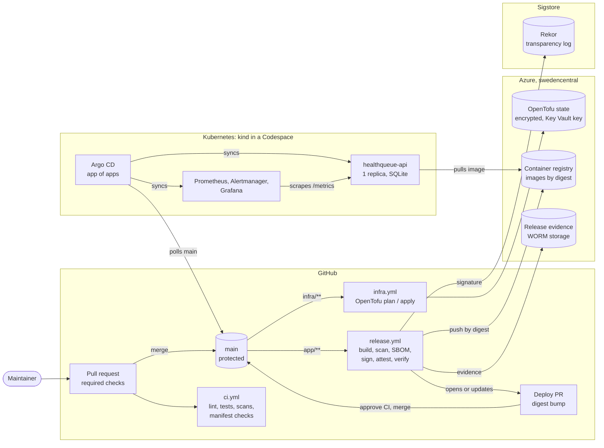

# Architecture

How HealthQueue's platform fits together: where code becomes an image, how that image reaches
the cluster, and what watches it there. Each part links to the decision record (ADR) that
explains why it is built that way.

**Audience:** CTO, reviewers, new engineers. **Owner:** platform engineering.

## The system on one page

All Azure access from GitHub uses short-lived OIDC tokens. No cloud keys or signing keys
exist ([ADR-0003](adr/0003-github-actions-workload-identity.md)).

## Components

| Part | What it does | Where | Why it is built this way |
|---|---|---|---|
| **API** | FastAPI appointment booking, `/metrics`, `/healthz`, `/readyz` | [`app/`](../app/) | One replica on SQLite with `Recreate`; PostgreSQL is the production path ([ADR-0005](adr/0005-sqlite-single-replica-data-store.md)) |
| **PR gate** | Ruff, pytest with an 85% coverage gate, hadolint, Trivy, kubeconform, promtool, DORA tests | [`ci.yml`](../.github/workflows/ci.yml) | Every job is a required check on `main` |
| **Infrastructure** | OpenTofu: state, registry, evidence storage, CI identities | [`infra/`](../infra/README.md), [`infra.yml`](../.github/workflows/infra.yml) | Encrypted remote state ([ADR-0002](adr/0002-opentofu-state-management.md)); one identity per job ([ADR-0003](adr/0003-github-actions-workload-identity.md)); region ([ADR-0001](adr/0001-azure-region-selection.md)) |
| **Release** | Build, Trivy gate, SBOM, push, cosign signature, SLSA provenance, verification, WORM evidence | [`release.yml`](../.github/workflows/release.yml) | [Supply chain and SLSA](supply-chain-slsa.md) |
| **Promotion** | A deploy pull request for every verified release; merge = deploy, revert = rollback | [`open-deploy-pr.sh`](../.github/scripts/open-deploy-pr.sh) | [ADR-0007](adr/0007-pr-driven-image-promotion.md) |
| **GitOps** | Argo CD syncs `main` and reverts manual changes; AppProjects limit each app | [`deploy/argocd/`](../deploy/README.md) | [ADR-0006](adr/0006-gitops-with-argo-cd.md) |
| **Workload** | Hardened Deployment under `restricted` Pod Security, default-deny NetworkPolicies, image pinned by digest | [`deploy/base/`, `deploy/overlays/prod/`](../deploy/README.md) | [Deploy README](../deploy/README.md) |
| **Registry pull** | Repository-scoped, expiring pull token on kind; kubelet identity on AKS | [`create-pull-secret.sh`](../deploy/scripts/create-pull-secret.sh) | [ADR-0004](adr/0004-registry-pull-authentication.md) |
| **Observability** | Two SLOs, multi-window burn-rate alerts with unit tests, provisioned dashboard | [`observability/`](../observability/), [`deploy/monitoring/`](../deploy/monitoring/) | [ADR-0008](adr/0008-observability-and-slos.md), [observability and SLOs](observability.md) |
| **Delivery metrics** | Seeded 90-day simulation, DORA metrics against the 2024 levels | [`dora/`](../dora/) | [DORA report](dora-report.md) |

## How a change reaches production

1. **Pull request.** The required checks run. Branch protection allows no direct pushes, and
   the branch must be up to date with `main`.
2. **Merge.** A change under `app/` starts `release.yml` in the `release` environment.
3. **Release.** The pipeline builds the image from a digest-pinned base and hash-locked
   dependencies. It then:
   - fails on any fixable HIGH or CRITICAL vulnerability;
   - writes an SBOM and pushes the image by digest;
   - signs it keylessly, attests provenance and the SBOM, and verifies all three as a
     consumer would;
   - writes the evidence to write-once storage.
4. **Deploy pull request.** `open-deploy-pr` proposes the new digest as a two-line change, or
   replaces the open proposal. Its CI is held until the maintainer approves it, a deliberate
   control ([ADR-0007](adr/0007-pr-driven-image-promotion.md)).
5. **Merge = deploy.** Argo CD picks up `main` within 3 minutes and rolls out. Rollback is
   reverting that merge.
6. **Watch.** Prometheus scrapes the API. Fast burn-rate alerts page, and slow ones open a
   ticket ([runbook](runbooks/slo-burn-rate.md)).

Infrastructure changes take the same route through `infra.yml`:

- **Pull request:** a read-only plan is posted to it.
- **Merge:** an apply runs in the `prod` environment.
- **Daily:** a drift check runs.

## Identities and trust boundaries

| Actor | Can | Cannot |
|---|---|---|
| Pull request CI | Read the repo, read state (plan identity) | Write anything in Azure; fork PRs get no token |
| `release` environment (`main` only) | Push images, write evidence | Change infrastructure, deploy to the cluster |
| `prod` environment (`main` only) | Apply OpenTofu inside `rg-healthqueue-prod` | Grant itself broad roles: its role-assignment right is ABAC-limited |
| `open-deploy-pr` (`promote` job) | Push the deploy branch and open a PR | Reach Azure or sign. It does not merge, but that is its script's choice, not a permission: its token can write contents and pull requests. The safeguard is that changes to the script and workflow go through review like any other ([ADR-0007](adr/0007-pr-driven-image-promotion.md)) |
| Argo CD | Read `main`, apply to its projects' namespaces | Accept credentials from CI: nothing outside pushes to the cluster |
| The cluster | Pull one repository, read-only | Push, or read other repositories |

The cluster is never reached from CI. It pulls from Git and the registry, so a compromised
workflow has no path to it.

## Course environment and production

| Concern | Course environment (built) | Production design |
|---|---|---|
| Cluster | kind in a Codespace | AKS in `eastus2`, paired with `centralus` ([ADR-0001](adr/0001-azure-region-selection.md)) |
| Registry pull | 30-day pull token, rotated by hand | Kubelet managed identity with `AcrPull`, no secret ([ADR-0004](adr/0004-registry-pull-authentication.md)) |
| Data | SQLite, one replica | PostgreSQL Flexible Server, zone-redundant, ≥ 2 replicas ([ADR-0005](adr/0005-sqlite-single-replica-data-store.md)) |
| Evidence retention | WORM, 7 days, unlocked | WORM locked at six years ([ADR-0003](adr/0003-github-actions-workload-identity.md)) |
| Grafana login | Per-cluster admin password | SSO ([ADR-0008](adr/0008-observability-and-slos.md)) |

All data is synthetic. No PHI is stored anywhere.

## Not built yet

| Gap | Effect today | Plan |
|---|---|---|
| **Signature check at admission** (phase 9, deferred) | The cluster does not verify signatures itself. Only digests merged through a reviewed deploy PR run | Kyverno `verifyImages` ([supply chain](supply-chain-slsa.md#gaps-and-roadmap)) |
| **SLSA Build L3** | Provenance comes from the same job as the build | Reusable build workflow ([supply chain](supply-chain-slsa.md#gaps-and-roadmap)) |
| **Staging and a smoke test** | Startup crashes reach production | [DORA report, recommendation 2](dora-report.md#2-smoke-test-each-release-before-it-reaches-production) |
| **GitHub App for the bot** | Every deploy PR needs an approval click | A trade of that control for speed, with criteria for when to make it ([DORA report, recommendation 1](dora-report.md#1-decide-when-to-trade-the-approval-click-for-speed)) |
