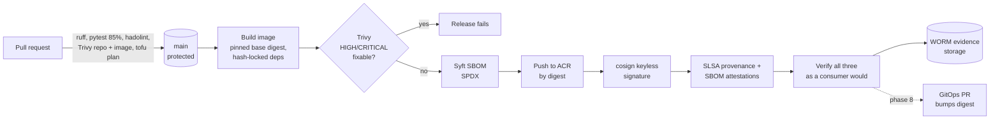

# Software supply chain and SLSA

How HealthQueue makes sure the container running in production is exactly what was reviewed,
built from known inputs, and free of known high-severity vulnerabilities, and how anyone can
check that independently.

**Audience:** CTO, security reviewers, auditors. **Owner:** platform engineering.

## Summary for leadership

| Question | Answer |
|---|---|
| Can someone push code to production without review? | No. `main` only accepts pull requests with passing checks; the release pipeline only runs from `main`. |
| Can someone swap the image after it is built? | No. Deployments reference an immutable digest, and every image is signed. A substituted image has no valid signature (enforcement at deploy time: phase 9). |
| Do we know what is inside each image? | Yes. Every release has an SBOM listing every package, signed and attached to the image. |
| Do we ship known vulnerabilities? | Not at HIGH or CRITICAL with a fix available. The pipeline refuses to publish. |
| Are there long-lived credentials that could be stolen? | No. Azure access and signing both use short-lived OIDC tokens. There is no signing key and no cloud secret. |
| Can we prove all of this to an auditor later? | Yes. Each release writes its evidence to write-once storage, and signatures are in the public Rekor transparency log. |
| SLSA level | **Build L2** today; L3 needs build isolation (see [Gaps](#gaps-and-roadmap)). |

## Pipeline



Workflows: [`ci.yml`](../.github/workflows/ci.yml) (PR gate),
[`release.yml`](../.github/workflows/release.yml) (publish),
[`infra.yml`](../.github/workflows/infra.yml) (infrastructure).

## Controls by threat

Threat letters follow the [SLSA threat model](https://slsa.dev/spec/v1.0/threats).

| Threat | Example | Control | Where |
|---|---|---|---|
| (A) Unreviewed source change | Direct push to `main` | Branch protection: PR required, required status checks, strict up-to-date, no force push, admins included | GitHub settings |
| (B) Compromised source repo | Stolen maintainer token pushes a tag | Releases only from `main` via the `release` environment; tags are not trusted | `release.yml`, ADR-0003 |
| (C) Build from modified source | Build runs a fork's code | Release runs only on `push` to `main`; fork PRs get no OIDC token or secrets | `release.yml` |
| (D) Compromised build platform | Persistent backdoor on a build host | Ephemeral GitHub-hosted runners; nothing is reused between runs except a content-addressed layer cache | GitHub Actions |
| (E) Compromised dependency | Malicious PyPI release, repointed action tag | Hash-locked Python deps (`pip --require-hashes`); base image pinned by digest; every action pinned by commit SHA; Dependabot proposes updates as reviewable PRs | `requirements.lock`, `Dockerfile`, workflows |
| (F) Upload modified package | Image replaced in the registry after build | Push by digest; cosign signature over the digest; consumers verify signer identity | `release.yml` |
| (G) Registry compromise | Tag `latest` repointed | Nothing deploys by tag. GitOps manifests pin `@sha256:` digests (phase 6+) | `deploy/` |
| (H) Use of a compromised package | Cluster runs an unsigned image | Kyverno `verifyImages` policy rejects images without a valid signature from `release.yml@refs/heads/main` | phase 9 |
| Known vulnerabilities | Shipping a fixable CVE | Trivy gate on PR and again at release (new CVEs appear between merge and release); full report kept as evidence | `ci.yml`, `release.yml` |
| Credential theft from CI | Exfiltrated cloud key | OIDC federation only; least-privilege identities per job; no signing keys | ADR-0003 |

## Why pin actions by commit SHA: the Trivy incident

On **19 March 2026**, an attacker with stolen credentials force-pushed **76 of 77 version tags**
of `aquasecurity/trivy-action` and all tags of `aquasecurity/setup-trivy` to credential-stealing
malware. They also published a malicious Trivy v0.69.4 release
([GHSA-69fq-xp46-6x23](https://github.com/advisories/GHSA-69fq-xp46-6x23), CVE-2026-33634).
The tags pointed at malicious commits for about 12 hours.

Any workflow that wrote `uses: aquasecurity/trivy-action@v0.x` ran the attacker's code with that
job's secrets and tokens. The tool meant to *find* supply-chain problems became one. Workflows
pinned to a commit SHA were unaffected: Git cannot make an existing SHA point at different
content.

What this repository does as a result:

- **Every `uses:` is a full 40-character commit SHA**, with the human-readable tag in a comment.
  Dependabot updates both together in a reviewable PR.
- **Prefer releases at least two weeks old.** Most malicious releases are detected and pulled
  within days. Waiting trades a little freshness for not being patient zero.
- **Transitive pins are checked.** `trivy-action` v0.36.0 itself pins `setup-trivy` and
  `actions/cache` by SHA. A SHA-pinned composite action that used tags internally would still be
  exposed.
- **The scanner binary version is pinned** (`TRIVY_VERSION`), not `latest`.
- **Jobs get the minimum token permissions** (`contents: read` by default). Jobs that need OIDC
  have no stored cloud secret to steal, so a compromised step can act only within that job's
  identity and lifetime.

## Signing and attestations

### What is produced for every release

| Artifact | Tool | Stored |
|---|---|---|
| Image signature | `cosign sign` (keyless, Sigstore Fulcio + Rekor) | OCI referrer in ACR; Rekor public log |
| SLSA v1 build provenance | `actions/attest` | OCI referrer in ACR; GitHub attestation store; Rekor |
| SBOM attestation (SPDX) | Syft + `actions/attest` | OCI referrer in ACR; GitHub attestation store; Rekor |
| Vulnerability report (all severities) | Trivy JSON | Evidence storage |
| Release record (`release.json`) | Workflow | Evidence storage |

**Keyless signing** means there is no private key to manage. Sigstore's Fulcio issues a
certificate valid for about 10 minutes, bound to this workflow's GitHub OIDC identity:

```
https://github.com/martineh4/healthqueue-platform/.github/workflows/release.yml@refs/heads/main
```

The signature is recorded in the Rekor transparency log, so a signature created outside this
workflow, even with stolen GitHub credentials on another branch, carries a different identity
and fails verification.

### Verifying a release yourself

```bash
IMAGE=crhealthqueueora3w.azurecr.io/healthqueue-api@sha256:<digest>
az acr login --name crhealthqueueora3w

# Signature: made by release.yml on main, and nothing else
cosign verify "$IMAGE" \
  --certificate-identity https://github.com/martineh4/healthqueue-platform/.github/workflows/release.yml@refs/heads/main \
  --certificate-oidc-issuer https://token.actions.githubusercontent.com

# Provenance: which commit, workflow and runner built it
gh attestation verify "oci://$IMAGE" --repo martineh4/healthqueue-platform \
  --signer-workflow martineh4/healthqueue-platform/.github/workflows/release.yml \
  --predicate-type https://slsa.dev/provenance/v1

# SBOM attestation
gh attestation verify "oci://$IMAGE" --repo martineh4/healthqueue-platform \
  --predicate-type https://spdx.dev/Document/v2.3
```

The release workflow runs these same commands before it finishes, so a release whose
signature or attestations do not verify fails in CI rather than at deploy time.

### Release evidence

Each run uploads to `release-evidence/healthqueue-api/<commit>/run-<id>-<attempt>/` in a storage
account with a **WORM immutability policy**. Neither the release identity nor an administrator
can modify or delete evidence during the retention period. The period is 7 days in this course
environment and 2190 days (six years, the HIPAA documentation period) in production; see
ADR-0003.

## SLSA assessment

Against [SLSA v1.0](https://slsa.dev/spec/v1.0/levels):

| Requirement | Level | Status | How |
|---|---|---|---|
| Provenance exists | Build L1 | Met | `actions/attest` SLSA v1 provenance for every image |
| Hosted build platform | Build L2 | Met | GitHub-hosted, ephemeral runners |
| Signed provenance, generated by the platform | Build L2 | Met | Signed with a Sigstore certificate bound to the workflow identity; verifiable with `gh attestation verify` |
| Isolated build; provenance unforgeable by the build steps | Build L3 | **Not met** | Provenance is generated in the same job as the build steps, so a malicious step could in principle tamper with it |

## Gaps and roadmap

| Gap | Risk | Plan |
|---|---|---|
| Build L3 | A compromised build step could forge provenance | Move build and attestation into a **reusable workflow**. Provenance then names that workflow as the builder, separate from the caller; verifiers pin `--signer-workflow` to it. |
| Deploy-time enforcement | Until phase 9, a signature is checked in CI but not by the cluster | Kyverno `verifyImages` with keyless attestor and the identity above |
| Single maintainer, zero required approvals | Two-person review (SLSA Source track) not possible | Require one approval and CODEOWNERS review when a second maintainer joins |
| Public registry and storage endpoints | Reachable from the internet; protected by Entra ID only | ACR Premium + private endpoint with self-hosted runners (ADR-0002/0003 risk acceptance expires 2027-04-30) |
| Base image freshness | New CVEs in `python:3.13-slim` between releases | Dependabot docker updates. Scheduled rebuild-and-rescan of the deployed digest (phase 10) |
